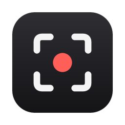
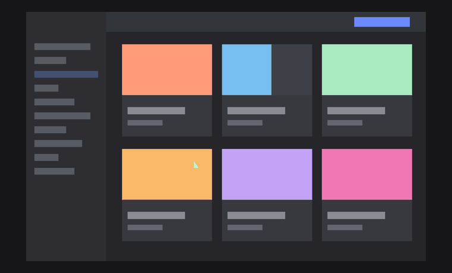

<p align="center">
  
</p>

<h1 align="center">Clipt</h1>

<p align="center">
  Screen recording for macOS that gets out of your way.<br>
  Small, fast and frictionless. Free and open source.
</p>

<p align="center">
  <a href="https://github.com/eduardoalba00/clipt/releases">Download</a>
  &nbsp;·&nbsp;
  <a href="#build-from-source">Build from source</a>
  &nbsp;·&nbsp;
  <a href="CONTRIBUTING.md">Contributing</a>
  &nbsp;·&nbsp;
  <a href="LICENSE">MIT License</a>
</p>

<p align="center">
  
</p>

Clipt is a lightweight screen recorder for the Mac. Press <kbd>⌘N</kbd>,
pick a screen, a window or an area, and record. When you stop, the
recording opens in a simple editor where you can trim it, crop it and give it
a clean background in a few seconds. Then export an MP4 that's already on your
clipboard.

No account. No uploads. No watermark. No subscription. Your recordings stay on
your Mac.

## Why Clipt

- **Fast to start.** One shortcut, one choice, recording. Stop from the menu
  bar or with <kbd>⌘⇧2</kbd>.
- **Frictionless.** Nothing to sign up for and nothing to configure. Clipt
  remembers your last style and gets out of the way.
- **Polished in seconds.** Backgrounds, padding, rounded corners, a soft
  shadow, an optional browser frame and a camera bubble, previewed live.
- **Lightweight.** About 8 MB. Built on Apple's own ScreenCaptureKit,
  AVFoundation and Core Image, with no ffmpeg and nothing running in the
  background.
- **Private by default.** Everything happens on your Mac. Clipt never talks to
  a server.
- **Keyboard first.** Every common action has a shortcut, and the shortcuts
  are shown where you need them.

## Features

| | |
| --- | --- |
| **Record** | Full screen or a single window (the system picker), or drag to select any area. The area being recorded stays lit while the rest of the screen dims. Optional microphone and camera. |
| **Trim** | A filmstrip with handles. Set in and out at the playhead with <kbd>I</kbd> and <kbd>O</kbd>. |
| **Crop** | Drag a frame on the preview, freely or locked to 16:9, 4:3, 1:1, 4:5 or 9:16. |
| **Style** | Eight background presets, any colour, or your own picture. Padding, corners and shadow. Output at Auto, 16:9, 4:3, 1:1 or 4:5. |
| **Frame** | Minimal browser chrome with an editable address, light or dark. |
| **Camera** | A round camera bubble in any corner, at any size. |
| **Export** | H.264 + AAC MP4, up to 1080p at 30 or 60 fps. Revealed in Finder and copied to the clipboard as a file, ready to paste. |
| **Import** | Drop in any .mov or .mp4, including macOS ⌘⇧5 recordings. |

Edits are a recipe on top of the original recording, with full undo, so
nothing is lost until you export. Exports go to `~/Movies/Clipt` and never
overwrite a file.

## Get started

Clipt runs on macOS 14 (Sonoma) or later and is built and tested on Apple
Silicon.

Prebuilt releases will be published on the
[Releases](https://github.com/eduardoalba00/clipt/releases) page. Until then,
build it from source; it takes a couple of minutes.

The first time you open Clipt, it asks for the permissions it needs: Screen
Recording, and the microphone and camera if you want them. You can revisit
them from the shield icon in the launcher.

### Build from source

You'll need [Rust](https://rustup.rs), Node.js 20 or newer, and Xcode's
command line tools.

```sh
git clone https://github.com/eduardoalba00/clipt.git
cd clipt
npm install
npm run tauri build
open src-tauri/target/release/bundle/macos/Clipt.app
```

Open the bundled `Clipt.app`, not the bare binary from a terminal: macOS
grants Screen Recording to whichever app launched the process.

For one build that runs on both Apple Silicon and Intel Macs:

```sh
rustup target add x86_64-apple-darwin
npm run tauri build -- --target universal-apple-darwin
```

It lands in `src-tauri/target/universal-apple-darwin/release/bundle/`.

Unsigned builds get a new signature every time, and macOS then forgets their
permissions. To keep them across rebuilds, give Clipt a stable identity once:

```sh
scripts/setup-signing.sh
APPLE_SIGNING_IDENTITY="Clipt Dev" npm run tauri build
```

## Shortcuts

| Key | Action |
| --- | --- |
| <kbd>⌘N</kbd> | New recording |
| <kbd>⌘⇧2</kbd> | Stop recording |
| <kbd>Space</kbd> | Play / pause |
| <kbd>I</kbd> / <kbd>O</kbd> | Set trim in / out |
| <kbd>C</kbd> | Crop |
| <kbd>⌘E</kbd> | Export |
| <kbd>⌘⇧O</kbd> | Open recordings |
| <kbd>⌘Z</kbd> / <kbd>⌘⇧Z</kbd> | Undo / redo |

## How it works

Clipt is a [Tauri 2](https://tauri.app) app. A Rust core does all the media
work through Apple's frameworks; a React interface only draws controls.

A single description of the frame, the `Scene`, drives both the live preview
and the export. A custom video compositor draws it with Core Image for the
preview player and for the exporter alike, so what you see is exactly what you
get. An automated test checks that the two produce identical frames.

Exports use constant-quality H.264 on the hardware encoder, so text stays
sharp on still screens without wasting space, and busy scenes get the bits
they need.

## Development

```sh
npm install
npm run tauri dev       # run with hot reload
npm run check           # typecheck, lint, clippy and tests
```

```
src-tauri/src/
  scene.rs      the frame layout, from the user's settings
  render.rs     Core Image compositing and the video compositor
  media.rs      a recording's files as one composition
  preview.rs    the native preview player under the interface
  export.rs     encoding the MP4
  record.rs     ScreenCaptureKit, area selection, mic and camera
  indicator.rs  dimming everything that isn't being recorded
  take.rs       recordings kept in Clipt's working folder
  macos.rs      window chrome, Finder and clipboard
src/
  components/   launcher, onboarding, editor, preview, inspector, timeline
  lib/          settings types, undo history, IPC, geometry
```

The Rust tests include an end-to-end export check (a clip generated in code is
exported and read back with AVFoundation) and the preview/export parity check.

## Contributing

Bug reports, ideas and pull requests are welcome. Please read
[CONTRIBUTING.md](CONTRIBUTING.md) first. Clipt aims to stay small, so new
features are discussed in an issue before they're built.

Everyone taking part is expected to follow the
[Code of Conduct](CODE_OF_CONDUCT.md). To report a security problem, see
[SECURITY.md](SECURITY.md).

## License

Clipt is released under the [MIT License](LICENSE). It adapts some interface
and window code from [MonoCode](NOTICE) and uses
[Hugeicons](https://hugeicons.com) free icons; see [NOTICE](NOTICE).
